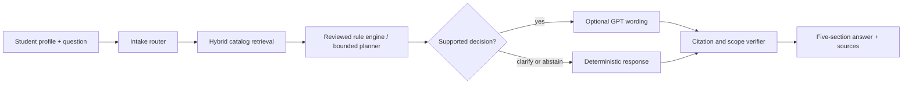

# Catalog-grounded course planning assistant — OSU pilot

The sourced, bounded pilot covers Oregon State University's 2026–27 CS Computer Systems program. `src/workflow.py` is the LangGraph entry point; `src/osu_app.py` supplies its deterministic rule and planning decisions. `src/course_planner.py` and `data/demo_catalog.json` are an older synthetic prototype retained for comparison; their metrics are not evidence of real-catalog performance.

New to the implementation? Start with [LEARNING_GUIDE.md](LEARNING_GUIDE.md). It explains the architecture, request flow, RAG, embeddings, rule engine, LangGraph, GPT boundary, verification, data, files, evaluation, extension process, interview questions, and official learning resources from first principles.

## Run the sourced pilot

Install `requirements.txt` first. The CLI now uses the local embedding model as well as the deterministic rule checker; model weights download on first use:

```bash
uv venv --python 3.11 .venv311
uv pip install --python .venv311/bin/python -r requirements.txt
.venv311/bin/python -m src.retrieval build
.venv311/bin/python -m src.evaluate_retrieval
.venv311/bin/python -m src.evaluate_osu
.venv311/bin/python -m src.report_assessment
.venv311/bin/python -m unittest src.test_assessment src.test_workflow -v

.venv311/bin/python -m src.workflow --no-gpt --question "Can I take CS261?" --profile examples/osu_profile.json
.venv311/bin/python -m src.workflow --question "Plan my next term" --profile examples/osu_profile.json
.venv311/bin/python -m src.retrieval search "What do I need before CS 261?"
.venv311/bin/python web_app.py
```

`src.workflow` runs `intake → retrieve → rules → write → verify`, with a conditional edge around `write` for clarification and unsupported questions. Copy `.env.example` to `.env` and set `OPENAI_API_KEY` locally to enable GPT wording; the project loads that file automatically. You can optionally set `OPENAI_MODEL` (default `gpt-5-mini`). `.env` is ignored by Git, and an environment variable already set in the shell takes precedence. Without a key, the `write` node uses the checked template and labels the result `generation_mode: template`. The graph exposes `workflow_trace`, retrieved passage IDs, and verification status. A model error also falls back to the checked template. The rules and plan never come from the model.

The local web demo at `http://127.0.0.1:8501` defaults to deterministic wording to avoid unnecessary API cost. Its optional GPT toggle uses `gpt-5-mini`; eligibility and planning decisions always remain deterministic. `--no-gpt` provides the same behavior in the CLI. The demo uses Python's standard HTTP server, so it adds no frontend framework dependency.

## Architecture



For offline graph and assessment checks, run `HF_HOME=/path/to/model-cache .venv311/bin/python -m unittest src.test_assessment src.test_workflow -v`. The workflow tests exercise malformed model drafts with a fake writer; they do not measure live GPT quality.

For live GPT evaluation and the sentence-level review procedure, see [GENERATION_EVAL.md](GENERATION_EVAL.md).
The corrected 27-case assessment metrics, grading rubric, and earlier live development run are documented in [EVALUATION_RESULTS.md](EVALUATION_RESULTS.md). The three PDF-required transcripts are in [EXAMPLE_TRANSCRIPTS.md](EXAMPLE_TRANSCRIPTS.md).

Verification checks citation IDs and metadata, course identity, multi-course chain evidence, program membership, credit limits, and basic draft constraints. It does **not** prove semantic entailment of every generated sentence; `semantic_entailment_checked: false` makes that limitation explicit.

`data/osu_2026_27.json` was generated from public OSU catalog HTML snapshots with:

```bash
python3 -m src.ingest_osu --snapshot-dir /path/to/saved/catalog-pages --output data/osu_2026_27.json
```

The generated corpus has 48 selected descriptions from **48 distinct official course-specific URLs**, two program pages, and two policy pages: 52 distinct source URLs in total, with 13,473 selected words. Each course-specific page was checked against the same course block in the department catalog. `data/osu_2026_27.json` records URLs, snapshot hashes, and access dates. The included corpus is usable offline; regenerating it from the live catalog may produce a new snapshot if the university edits its pages. See [SOURCES.md](SOURCES.md) for provenance and reproduction.

## What works now

- A reviewed subset of course prerequisites with AND/OR, grade thresholds, placement-score branches, and three-valued decisions (`eligible`, `not_eligible`, `needs_more_info`).
- Retrieved source citations with catalog URL, heading, and passage ID. A verifier checks citation metadata, target course identity, program-course membership, and plan credit bounds before returning a decision or plan. It does not independently prove that every parsed rule faithfully captures the catalog; manual rule review remains necessary.
- A bounded candidate plan from reviewed required courses with a credit limit and explicit offering uncertainty.
- The PDF-required 25-query mix (10 direct, five chain, five program, five abstention) plus two plan cases. All development checks pass; see the evaluation report for denominators and limitations.
- Program answers for major/option totals, restricted and approved elective credits, excluded restricted-elective numbers, grading mode, corequisite meaning, and concurrent-prerequisite meaning.
- Course-code and selected course-name lookup, including “Database Systems.”
- A local web demo showing Answer/Plan, Why, Citations, Clarifying Questions, Assumptions/Not in Catalog, and Next Steps.
- A local vector index with 99 passages embedded by `BAAI/bge-small-en-v1.5` (384 dimensions), cosine similarity via normalized dot product, top-k=5, and exact course-code/metadata boosts. Course descriptions remain one passage each; long program/policy pages use 230-word chunks with 35-word overlap. The 12-case passage-level retrieval set scores recall@5 12/12 and MRR@5 0.958 on the same queries used during tuning; independent validation is still needed.

## Remaining limitations and publication work

- Manual review and coverage of the rest of the selected course rules, option electives, corequisites, repeats, transfer equivalencies, and policy exceptions.
- Resolve ambiguous prerequisite grouping in CS 325 with an authoritative source or preserve the escalation path.
- The data-size floor is met through the PDF's alternative 25+ distinct pages/documents route: 48 course-specific pages, two program pages, and two policy pages. The focused text is below 30,000 words, so do not claim the word-count route.
- Compare retrieval variants and expand independent evaluation. `src.osu_app` is the deterministic CLI; `src.workflow` adds optional GPT wording while keeping decisions in the rule engine.
- Obtain independent human review of sentence-level support for the 17 live GPT drafts and test a held-out case set. Current automated checks are structural and scope-based, and the assistant audit is not an independent review.
- Obtain independent human review and a held-out validation set before making a broad accuracy claim on a resume.
- Publish the repository to GitHub and record a 1–2 minute demo when ready; publishing requires the owner's GitHub destination and authorization.

See [ASSESSMENT1_DESIGN.md](ASSESSMENT1_DESIGN.md) and [RULE_REVIEW.md](RULE_REVIEW.md) for source and rule decisions.
# Prerequisite-course-planning-assistant
