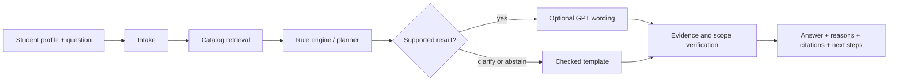

# Catalog-Grounded Course Planning Assistant

A course-planning pilot for Oregon State University's 2026–27 CS Computer Systems program. It retrieves official catalog evidence, evaluates reviewed prerequisite rules against a student profile, and returns eligibility decisions or a bounded next-term plan with citations.

## Highlights

- 52 official catalog sources: 48 course pages, two program pages, and two policy pages.
- Hybrid retrieval over 99 passages using local BGE embeddings and exact course-code boosts.
- Deterministic prerequisite checks for AND/OR rules, grade thresholds, placement scores, and missing information.
- Citation and scope verification for course decisions, prerequisite chains, and proposed plans.
- LangGraph workflow with inspectable state and execution traces.
- Command-line interface and dependency-free local web demo.
- Explicit abstention for unsupported questions and ambiguous catalog rules.

## How AI is used

The local embedding model is used to retrieve relevant catalog passages. An OpenAI model can optionally rewrite a verified result as one concise sentence.

Eligibility decisions, prerequisite evaluation, and course selection are performed by deterministic Python rules—not by GPT. The application works without an OpenAI API key, and the web demo keeps GPT wording disabled by default.

## Architecture



The workflow is implemented as `intake → retrieve → rules → write → verify`. Clarification and unsupported requests bypass the optional writing step.

## Quick start

Python 3.11 and [`uv`](https://docs.astral.sh/uv/) are recommended.

```bash
uv venv --python 3.11 .venv311
uv pip install --python .venv311/bin/python -r requirements.txt
.venv311/bin/python -m src.retrieval build
```

Run a deterministic course check:

```bash
.venv311/bin/python -m src.workflow \
  --no-gpt \
  --question "Can I take CS374?" \
  --profile examples/osu_profile.json
```

Run the local web demo:

```bash
.venv311/bin/python web_app.py
```

Then open `http://127.0.0.1:8501`.

### Optional GPT wording

Copy `.env.example` to `.env` and add the API key locally:

```text
OPENAI_API_KEY=your_key
OPENAI_MODEL=gpt-5-mini
```

`.env` is ignored by Git. If no key is available—or if generation or verification fails—the checked deterministic response is returned.

## Evaluation

The included development evaluation reports:

| Check | Result |
|---|---:|
| Eligibility cases | 15/15 |
| Abstention cases | 5/5 |
| Catalog-claim citation coverage | 22/22 |
| Prerequisite-chain evidence | 5/5 |
| Plan credit-limit checks | 2/2 |
| Retrieval recall@5 | 12/12 |
| Retrieval MRR@5 | 0.958 |
| Automated tests | 15 passing |

Run the checks locally:

```bash
.venv311/bin/python -m src.evaluate_retrieval
.venv311/bin/python -m src.evaluate_osu
.venv311/bin/python -m src.report_assessment
.venv311/bin/python -m unittest src.test_assessment src.test_workflow -v
```

These are bounded development results, not a claim of universal advising accuracy. See [EVALUATION_RESULTS.md](EVALUATION_RESULTS.md) for cases, denominators, and interpretation.

## Data and retrieval

`data/osu_2026_27.json` contains normalized text and provenance from official OSU catalog pages, including URLs, access dates, and snapshot hashes. Course descriptions remain intact as individual passages; longer program and policy pages are divided into 230-word chunks with 35-word overlap.

`BAAI/bge-small-en-v1.5` produces 384-dimensional embeddings. The index uses normalized dot-product similarity, top-k retrieval, and exact identifier or metadata boosts. The corpus and index are included for offline use.

See [SOURCES.md](SOURCES.md) for provenance and reproduction instructions.

## Project map

| Path | Purpose |
|---|---|
| `web_app.py` | Local frontend and JSON endpoint |
| `src/workflow.py` | LangGraph orchestration and output verification |
| `src/osu_app.py` | Question routing and bounded planning |
| `src/osu_rules.py` | Reviewed rules and three-valued evaluation |
| `src/retrieval.py` | Passage construction, embeddings, and search |
| `src/evidence.py` | Citation and plan-evidence verification |
| `src/evaluate_*.py` | Retrieval, decision, and generation evaluation |
| `data/` | Catalog corpus, passage metadata, and vector index |
| `examples/` | Example student profiles |

For a from-first-principles walkthrough of the implementation, data flow, RAG, rules, LangGraph, evaluation, debugging, and interview preparation, read [LEARNING_GUIDE.md](LEARNING_GUIDE.md).

## Scope and limitations

- The pilot supports one program and catalog year.
- Only manually reviewed prerequisite rules are automated.
- Ambiguous rules such as CS325 return `needs_more_info` rather than being guessed.
- Term offerings, available seats, timetable conflicts, transfer equivalencies, and advisor approvals are not verified.
- Automated citation checks validate source identity and scope; they do not prove full semantic entailment of every sentence.
- The planner proposes eligible reviewed requirements within a credit limit; it is not a graduation-schedule optimizer.

Design and review details are available in [ASSESSMENT1_DESIGN.md](ASSESSMENT1_DESIGN.md) and [RULE_REVIEW.md](RULE_REVIEW.md).
