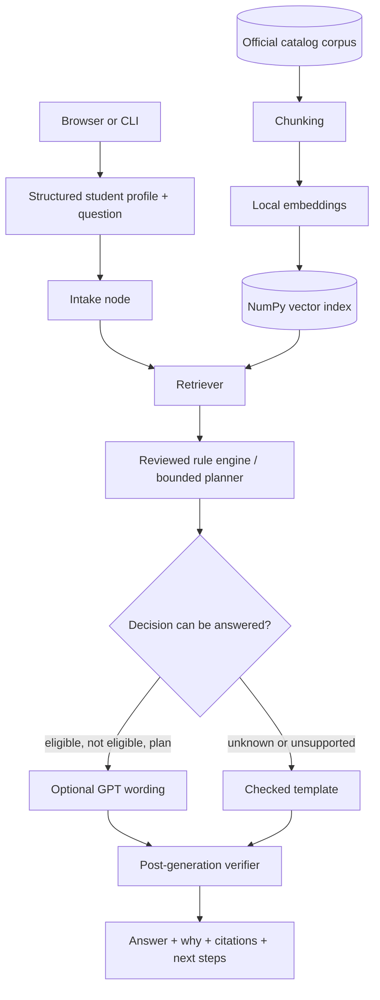

# Learning guide: catalog-grounded course planning assistant

This is the companion guide for someone who did not write the code and wants to understand it well enough to run it, modify it, debug it, and explain it honestly in an interview.

The project is a **bounded, catalog-grounded course-planning assistant** for Oregon State University's 2026–27 CS Computer Systems program. It answers selected prerequisite and program-policy questions and can propose a limited next-term plan. It is intentionally safer than a normal chatbot: official catalog evidence is retrieved, decisions come from reviewed Python rules, unsupported questions are rejected, and GPT is optional and may only rewrite an already checked answer.

## 1. The shortest useful explanation

### One-sentence resume/interview pitch

> I built a citation-backed course-planning assistant that combines local semantic retrieval over 52 official catalog pages, a deterministic three-valued prerequisite engine, a LangGraph workflow, optional schema-constrained GPT wording, and post-generation verification.

### What problem it solves

A student normally has to search many catalog pages, interpret expressions such as `(CS 261 or CS 261H) and CS 274`, compare them with a transcript, and remember that the catalog does not prove future availability. A plain chatbot can sound confident while inventing a prerequisite or overlooking an `AND` branch.

This project turns that task into five explicit stages:

1. Understand whether the user wants a course check, a plan, or something else.
2. Retrieve relevant official catalog passages.
3. Evaluate reviewed prerequisite/program rules against structured student data.
4. Optionally ask GPT to express the checked result in one sentence.
5. Verify citation metadata and scope before returning the result.

## 2. What it is—and what it is not

It is:

- a focused RAG application;
- a deterministic decision-support system;
- a LangGraph workflow with visible state and control flow;
- a local web demonstration and command-line application;
- an evaluated pilot with citations and explicit abstention.

It is not:

- a university registration system;
- a replacement for an academic advisor;
- a fully autonomous agent choosing arbitrary tools;
- a general assistant for every OSU program;
- a model trained or fine-tuned on the catalog;
- proof that a course is offered in a particular term.

Calling it an **agentic workflow** or **course-planning assistant** is accurate. Calling it a fully autonomous multi-agent system would not be accurate.

## 3. Architecture



The important design choice is that the LLM is **not** the decision-maker. A Python rule engine determines eligibility. This gives the system repeatable behavior, inspectable traces, and testable logic.

## 4. Follow one request from start to finish

Suppose the user asks:

> Can I take CS374?

and provides this profile:

```json
{
  "catalog_year": "2026-2027",
  "target_program": "CS Computer Systems",
  "target_term": "Fall",
  "max_credits": 12,
  "transcript_complete": true,
  "completed_courses": {
    "CS261": "B",
    "CS274": "C",
    "CS271": "B"
  }
}
```

### Step 1: the frontend creates a request

`web_app.py` collects the question and form fields. It converts text such as `CS261:B, CS274:C` into a Python dictionary, then sends the request to `src.workflow.run()`.

The browser is only a user interface. It does not perform retrieval or decide eligibility.

### Step 2: intake classifies the request

`src/workflow.py::intake` detects the course code `CS374`. It records:

```text
mode = course
course = CS374
trace = [intake]
```

The state is a shared dictionary passed between LangGraph nodes.

### Step 3: retrieval finds catalog evidence

`src/workflow.py::retrieve` converts the request into a search query similar to:

```text
CS374 course description prerequisites
```

`src/retrieval.py::Retriever.search` embeds that query, compares it with all stored passage vectors, applies an exact course-code boost, and returns the best passages. Retrieval helps locate evidence; it does not decide whether the student qualifies.

### Step 4: the rule engine evaluates the transcript

`src/osu_rules.py` encodes the manually reviewed CS374 expression:

```python
all_of(
    any_of(course("CS261"), course("CS261H")),
    course("CS274"),
    any_of(course("CS271"), course("ECE204"), course("ECE271")),
)
```

In ordinary language:

```text
(CS261 or CS261H) AND CS274 AND (CS271 or ECE204 or ECE271)
```

The engine compares each leaf with the profile and checks the minimum grade. With the sample profile, all three branches are satisfied, so the deterministic result is `eligible`.

### Step 5: the application assembles citations

`src/osu_app.py` produces the checked result and `src/evidence.py` gathers source-linked passages for CS374 and the prerequisite chain. Citation objects contain:

```json
{
  "url": "official catalog URL",
  "section": "catalog heading",
  "passage_id": "stable local passage identifier"
}
```

### Step 6: GPT is optional

If GPT is disabled, the checked template becomes the answer. If it is enabled, the model receives only the checked facts, allowed citations, and supporting passages. It is asked for one concise sentence in the `Draft` schema:

```python
class Draft(BaseModel):
    summary: str
    citation_ids: list[str]
```

The model cannot edit the rule, transcript, plan, or deterministic decision. If the API call fails, the application falls back to the template.

### Step 7: verification acts as the final gate

`src/workflow.py::verify` checks that:

- citation IDs exist;
- each citation's URL and heading match the stored metadata;
- a course answer cites the target course;
- a plan stays within the requested credit limit;
- every planned course has both a course citation and program-membership evidence;
- a GPT draft uses only allowed citation IDs;
- a GPT draft does not contradict the checked decision;
- the draft does not add unapproved course codes or availability claims.

If the draft fails, the system keeps the verified deterministic template. This is a structural and scope verifier, not a complete natural-language entailment checker; the output explicitly records `semantic_entailment_checked: false`.

## 5. RAG, explained from first principles

RAG means **Retrieval-Augmented Generation**. Instead of expecting a language model to remember the catalog, the application retrieves relevant source text at request time and supplies that evidence to later steps.

### 5.1 Ingestion

`src/ingest_osu.py` converts saved official catalog pages into `data/osu_2026_27.json`. The corpus records source URL, heading, access date, snapshot hash, text, document kind, and course code where applicable.

The checked-in corpus contains:

- 48 official course-specific pages;
- 2 program pages;
- 2 policy pages;
- 52 distinct source URLs total.

The project uses the assignment's alternative minimum of 25+ distinct pages/documents. It should not claim the separate 30,000-word route.

### 5.2 Chunking

Embedding an entire long policy page as one vector can hide the specific paragraph a query needs. The `passages()` function therefore splits long program and policy pages into approximately 230-word chunks with 35-word overlap.

Course descriptions remain one passage each because they are short and their prerequisite statement should stay together.

Overlap prevents an important sentence at a chunk boundary from losing its surrounding context.

### 5.3 Embeddings

An embedding model converts text into a vector—a list of numbers representing semantic meaning. This project uses the local model `BAAI/bge-small-en-v1.5`, producing 384-dimensional vectors through FastEmbed.

Example intuition:

```text
"database prerequisite"  -> [0.12, -0.08, ... 384 values]
"requirements for CS340" -> [0.11, -0.06, ... 384 values]
```

Their wording differs, but their vectors should be close because the meanings are related. This is not model training; it is inference with an existing embedding model.

### 5.4 The vector index

`data/osu_vectors.npz` stores normalized passage vectors. `data/osu_passages.json` stores matching text and metadata. Their row positions correspond: vector 17 describes metadata row 17.

The metadata also stores a SHA-256 hash of the corpus. If the corpus changes without rebuilding the index, the retriever raises an error instead of silently using stale vectors.

### 5.5 Similarity search

At query time, the query is embedded and normalized. The code calculates a dot product against every normalized passage vector. For unit-length vectors, dot product is cosine similarity:

```text
similarity(query, passage) = query_vector · passage_vector
```

Higher scores mean closer semantic direction. This corpus is small, so an exact NumPy scan is simpler than operating a separate vector database.

### 5.6 Hybrid ranking

Pure semantic similarity is not ideal for exact identifiers. If the user types `CS374`, that code is stronger evidence than a vaguely similar paragraph. The retriever therefore adds boosts for:

- exact course-code matches;
- major/degree terms;
- Computer Systems option and restricted-elective terms;
- selected registration-policy terms.

This is a lightweight hybrid of semantic and lexical/metadata retrieval.

### 5.7 Why this is genuinely RAG

The system retrieves passages from a source corpus and uses them to ground the answer and optional generation. The `R` and `A` are essential even when GPT is disabled. “Generation” can be a deterministic answer template; with GPT enabled, retrieved evidence also constrains the model-written sentence.

### Why RAG alone is not enough here

Retrieval can find the string `CS261 or CS261H and CS274`, but nearest-neighbor search does not reliably evaluate Boolean prerequisites, grades, missing transcript data, or credit sums. This project uses RAG for evidence and deterministic rules for decisions.

## 6. The deterministic rule engine

### Expression trees

Rules are nested dictionaries built with four helper functions:

- `course(code, grade="C", concurrent=False)` creates a course requirement;
- `placement(kind, score)` creates a placement-score condition;
- `all_of(...)` means every child is required;
- `any_of(...)` means at least one child is required.

This creates a tree. Internal nodes are `AND`/`OR`; leaves are observable facts about courses, grades, or placement scores.

### Three-valued logic

The engine returns one of three internal states:

| Internal state | User-facing decision | Meaning |
|---|---|---|
| `satisfied` | `eligible` | Available data proves the rule passes. |
| `unsatisfied` | `not_eligible` | A complete transcript proves the rule does not pass. |
| `unknown` | `needs_more_info` | Data or authoritative interpretation is missing. |

This is safer than Boolean-only logic. If a grade is missing, “false” would wrongly imply failure. `unknown` asks for clarification.

The operators propagate uncertainty deliberately:

- `AND`: one false child makes the expression false; otherwise an unknown child makes it unknown.
- `OR`: one true child makes the expression true; otherwise an unknown child makes it unknown.

### Grade comparison

`GRADE_RANK` maps grades to ordered numbers. The engine compares the completed grade with the rule's minimum. For example, `B >= C` passes while `C- >= C` does not.

### Concurrent courses

Some rules explicitly permit a prerequisite concurrently. An in-progress concurrent course remains `unknown` because its final grade is not yet established; the project avoids claiming completed eligibility from an unfinished class.

### Ambiguous rules and abstention

Rules such as CS325 are listed in `UNRESOLVED` when the displayed catalog's `AND`/`OR` grouping is ambiguous. The application returns `needs_more_info` rather than guessing. This is a strength: production AI systems must know when not to answer.

## 7. Planning logic

The planner is intentionally bounded. It is not an optimizer that produces a perfect graduation schedule.

For a plan request, `src/osu_app.py`:

1. requires catalog year, program, target term, credit limit, and completed courses;
2. checks that the requested program is the supported pilot;
3. requires a complete transcript;
4. enforces a normal maximum at or below 19 credits unless separately reviewed;
5. examines reviewed required courses not already completed;
6. runs the prerequisite checker for each candidate;
7. includes only `eligible` courses with both course and program evidence;
8. adds candidates in sorted order while staying inside the requested credit limit;
9. warns that offering, seats, schedule conflicts, and transfer approvals are not verified.

Because it uses sorted eligible requirements rather than optimization, call the result a **candidate bounded plan**, not an optimal schedule.

## 8. LangGraph without the mystery

LangGraph lets the code represent a workflow as **state + nodes + edges**.

- **State** is the shared `WorkflowState` dictionary.
- A **node** is a Python function that reads state and returns updates.
- An **edge** says which node runs next.
- A **conditional edge** selects the next path from current state.

The graph in `src/workflow.py` is:

```text
START -> intake -> retrieve -> rules -> (write or verify) -> verify -> END
```

The node responsibilities are:

| Node | Responsibility | Uses an LLM? |
|---|---|---|
| `intake` | Detect plan/course/other mode and course code. | No |
| `retrieve` | Find relevant catalog passages. | No; local embedding model only |
| `rules` | Run deterministic answer or planning logic. | No |
| `write` | Optionally rewrite checked facts in one sentence. | Yes, when enabled |
| `verify` | Validate evidence, plan bounds, and draft constraints. | No |

The conditional edge skips GPT for clarification, unsupported, and uncertain answers. This saves cost and avoids decorating an answer that the system cannot support.

Why use LangGraph when ordinary Python could work? It makes state transitions, branching, traces, and future extensions explicit. For this small pilot it is partly an architectural demonstration; the core business rules remain ordinary testable Python.

## 9. GPT's deliberately limited role

The default configured model is `gpt-5-mini`, chosen as a lower-cost wording model rather than a high-reasoning decision-maker. The frontend defaults GPT **off**.

When enabled, GPT may:

- write one concise sentence from checked facts;
- return only the allowed citation IDs;
- improve readability.

GPT may not:

- determine eligibility;
- parse or invent a new prerequisite rule;
- add courses to a plan;
- claim availability, seats, or timetable compatibility;
- cite passages outside the allowed set.

Pydantic defines the expected output schema. Structured output reduces format variability, but the application still validates the draft because schema conformance does not prove factual correctness.

## 10. Data files and schemas

### `data/osu_2026_27.json`

This is the source corpus. Conceptually:

```json
{
  "documents": [
    {
      "doc_id": "cs-cs374",
      "kind": "course",
      "course_code": "CS374",
      "heading": "...",
      "url": "https://catalog.oregonstate.edu/...",
      "text": "...",
      "accessed": "...",
      "snapshot_sha256": "..."
    }
  ]
}
```

### `data/osu_passages.json`

Generated passage text and metadata. Rebuild it rather than hand-editing it.

### `data/osu_vectors.npz`

Compressed NumPy array containing the vectors. It is binary and should not be edited manually.

### `examples/osu_profile.json`

A runnable student-profile example. Modify this file to experiment safely.

### `results/assessment_metrics.json`

Machine-readable assessment summary created from the labeled cases.

## 11. File-by-file map

### Start here

| File | Why it matters |
|---|---|
| `README.md` | Setup, commands, architecture summary, current capabilities and limits. |
| `docs/learning-guide.md` | This from-first-principles explanation. |
| `web_app.py` | Local frontend, HTTP endpoint, form validation, and result rendering. |
| `src/workflow.py` | LangGraph orchestration, GPT boundary, and final draft verifier. |

### Core application

| File | Responsibility |
|---|---|
| `src/osu_app.py` | Routes supported questions, builds policy answers, checks courses, and creates bounded plans. |
| `src/osu_rules.py` | Reviewed prerequisite trees, program sets, grade ordering, and three-valued evaluation. |
| `src/retrieval.py` | Chunking, embeddings, vector-index construction, and hybrid search. |
| `src/evidence.py` | Citation construction and verification for courses, chains, and plans. |
| `src/config.py` | Safely loads local `.env` values without overriding shell variables. |

### Data construction and review

| File | Responsibility |
|---|---|
| `src/ingest_osu.py` | Converts saved official catalog pages into the normalized corpus. |
| `src/fetch_course_pages.py` | Supports acquiring the selected catalog pages. |
| `src/audit_rules.py` | Audits relationships between encoded rules and source coverage. |
| `docs/sources.md` | Provenance and corpus reproduction notes. |
| `docs/rule-review.md` | Manual rule-review status and unresolved cases. |
| `docs/assessment-design.md` | Scope and design choices traced to Assignment 1. |

### Evaluation and tests

| File | Responsibility |
|---|---|
| `src/evaluate_retrieval.py` | 12-query passage retrieval benchmark. |
| `src/evaluate_osu.py` | 27 labeled decision/program/abstention/plan cases. |
| `src/evaluate_generation.py` | Live generation checks and audit support. |
| `src/report_assessment.py` | Produces the assessment metrics artifact. |
| `src/test_assessment.py` | Regression tests for assignment-level behavior. |
| `src/test_workflow.py` | Graph and adversarial/fake-writer verification tests. |
| `docs/evaluation-results.md` | Metrics, denominators, interpretation, and limitations. |
| `docs/generation-evaluation.md` | Procedure for evaluating optional GPT wording. |
| `docs/example-transcripts.md` | Required example conversations. |

### Deliverables

| File | Responsibility |
|---|---|
| `docs/submission-writeup.md` | Concise submission-oriented report. |
| `docs/project-writeup.md` | Broader project narrative. |
| `output/pdf/course_planning_assistant_writeup.pdf` | One-page rendered write-up. |

### Legacy comparison

`legacy/course_planner.py`, `legacy/evaluate.py`, `legacy/data/demo_catalog.json`, and `legacy/examples/student_profile.json` are the earlier synthetic prototype. They are retained for comparison but are not the sourced OSU pilot and their metrics must not be presented as real-catalog performance.

## 12. How to run it

Run commands from the repository root.

### Install

```bash
uv venv --python 3.11 .venv311
uv pip install --python .venv311/bin/python -r requirements.txt
```

The embedding model downloads on first use. It is then cached locally.

### Rebuild the retrieval index

```bash
.venv311/bin/python -m src.retrieval build
```

Run this after changing the source corpus or chunking configuration.

### Search the index directly

```bash
.venv311/bin/python -m src.retrieval search "What do I need before CS 261?"
```

This is useful for separating retrieval debugging from rule debugging.

### Run the deterministic CLI

```bash
.venv311/bin/python -m src.workflow \
  --no-gpt \
  --question "Can I take CS374?" \
  --profile examples/osu_profile.json
```

### Run the web frontend

```bash
.venv311/bin/python web_app.py
```

Open `http://127.0.0.1:8501`. The GPT checkbox is off by default.

### Enable optional GPT wording

Keep the real secret in `.env`, never `.env.example`:

```text
OPENAI_API_KEY=your_real_key
OPENAI_MODEL=gpt-5-mini
```

`.env.example` should contain placeholders only. `.env` is ignored by Git.

### Run evaluation and tests

```bash
.venv311/bin/python -m src.evaluate_retrieval
.venv311/bin/python -m src.evaluate_osu
.venv311/bin/python -m src.report_assessment
.venv311/bin/python -m unittest tests.test_assessment tests.test_workflow -v
```

## 13. How to debug it methodically

Use the stage where the behavior first becomes wrong:

| Symptom | Inspect first |
|---|---|
| Wrong catalog passage appears | `src/retrieval.py`, then run direct search. |
| Correct passage but wrong eligibility | `src/osu_rules.py` and the input profile. |
| Correct decision but wrong citations | `src/evidence.py` and passage metadata. |
| Correct backend but broken page | Browser console and `web_app.py`. |
| GPT changes meaning or adds a claim | `write()` prompt and `verify()` constraints. |
| Index says corpus changed | Rebuild with `python -m src.retrieval build`. |
| `needs_more_info` appears unexpectedly | Check transcript completeness, missing grade, honors flag, or `UNRESOLVED`. |

The `workflow_trace`, `retrieved_passage_ids`, `generation_mode`, and `verification` fields are included specifically to make this inspection possible.

## 14. How to extend the project

### Add a reviewed course rule

1. Confirm that the course page exists in the corpus.
2. Read the official prerequisite text carefully.
3. Encode it in `RULES` using `all_of`, `any_of`, `course`, and `placement`.
4. If grouping is ambiguous, add it to `UNRESOLVED` instead of guessing.
5. Add positive, negative, and missing-data cases.
6. Confirm the answer cites the target course and relevant chain pages.
7. Run all tests and update rule-review documentation.

### Add more catalog data

1. Save or acquire the official page.
2. Run ingestion to regenerate the corpus.
3. Review normalized text and metadata.
4. Rebuild the vector index.
5. Add retrieval benchmark cases.
6. Add rules only after manual source review.

### Support another program or university

This is a larger change. Separate institution/program configuration from the current OSU constants, create a new sourced corpus, define new program membership and policies, encode/review rules, and build an independent evaluation set. Do not simply change the UI label.

### Change the GPT model

Set `OPENAI_MODEL` in `.env` or pass `--model`. The model is not responsible for reasoning over prerequisites, so prefer an economical model with reliable structured output. Re-run generation evaluation after changing it.

## 15. Evaluation: what the numbers mean

Current development results include:

- 15/15 eligibility cases correct;
- 5/5 abstention cases correct;
- 22/22 catalog-claim responses with citations;
- 23/27 responses with citations overall (the four intentionally unsupported catalog questions make no catalog claim);
- 5/5 chain-evidence checks valid;
- 2/2 plan credit-limit checks valid;
- retrieval recall@5 of 12/12 and MRR@5 of 0.958 on the 12-case development set;
- 15 automated tests passing.

Definitions:

- **Accuracy**: fraction of labeled decisions equal to expected decisions.
- **Abstention accuracy**: fraction of deliberately unsupported/ambiguous questions correctly refused.
- **Recall@5**: whether the gold passage appeared anywhere in the first five retrieval results.
- **MRR@5**: rewards the gold passage for appearing nearer rank 1; reciprocal rank is `1/rank`.
- **Citation coverage**: whether a response that makes a catalog claim includes a citation.
- **Citation verification**: whether cited IDs and metadata match stored passages and required scope.

These are development-set results, not proof of universal accuracy. The retrieval queries were used during tuning, the rule set is bounded, and sentence-level semantic support still needs independent human review. A careful resume claim names the test size and scope.

## 16. Limitations worth saying out loud

- Only one OSU program/catalog-year pilot is supported.
- Many catalog rules still need manual encoding and review.
- CS325 and several related rules deliberately abstain because grouping is ambiguous.
- The planner does not verify live term offering, seats, timetable conflicts, advisor approval, or transfer equivalencies.
- The vector search benchmark is small and not held out.
- Automated citation checks validate identity and scope, not full semantic entailment of every sentence.
- The program does not authenticate users or store profiles in a production database.
- The local HTTP server is a demo, not hardened production hosting.

Knowing limitations is part of knowing the project.

## 17. Interview questions you should be ready for

### “Why did you combine RAG with rules?”

RAG locates evidence and provides traceable citations, but prerequisite checking requires reliable Boolean logic, grade thresholds, and explicit uncertainty. Rules make the decision deterministic; retrieval grounds it in the catalog.

### “Where is the agent?”

The LangGraph workflow coordinates multiple stateful stages and chooses a conditional path, so it is an agentic workflow. It is not an autonomous ReAct-style agent. The control flow is intentionally bounded because academic eligibility is a high-consequence decision.

### “Why is GPT not deciding eligibility?”

LLM output can vary and can misread nested `AND`/`OR` rules. Eligibility is easier to test and audit as deterministic code. GPT is used only where its strength—natural wording—adds value without controlling the decision.

### “What happens when data is missing?”

The three-valued engine returns `unknown`, surfaced as `needs_more_info`, and provides a targeted clarification. It does not treat unknown as false or silently assume a grade.

### “How do you reduce hallucination?”

The project limits scope, retrieves official passages, separates decisions from generation, constrains model output to a schema, supplies only allowed evidence, verifies citation IDs and course scope, rejects availability claims, falls back to deterministic wording, and abstains on ambiguous rules.

### “Why not use a vector database?”

The corpus has only 99 passages. A normalized NumPy matrix with exact scanning is fast, reproducible, dependency-light, and easy to inspect. A vector database becomes useful with much larger corpora, frequent updates, metadata filtering at scale, or distributed serving.

### “What would you do next?”

Expand reviewed rules, resolve ambiguities with authoritative sources, build a held-out query set, obtain independent human review of generated claims, add live schedule integration as a separately sourced tool, improve planning with constraints/optimization, add authentication and observability, and deploy behind a production web service.

## 18. Suggested learning order

### Day 1: run and observe

- Read `README.md`.
- Run the no-GPT CLI and web app.
- Ask one eligible, one ineligible, one missing-data, and one unsupported question.
- Compare `workflow_trace` and citations.

### Day 2: understand Python data flow

- Read `web_app.py` and `src/workflow.py`.
- Trace one request using the seven steps in this guide.
- Learn dictionaries, functions, type hints, and JSON serialization as needed.

### Day 3: understand RAG

- Read `src/retrieval.py`.
- Run direct searches and inspect scores.
- Change a query while keeping the intended passage the same.
- Learn embeddings, normalization, dot product, chunking, and top-k.

### Day 4: understand rules

- Read `src/osu_rules.py`.
- Draw CS374 as an AND/OR tree.
- Manually predict `eligible`, `not_eligible`, and `needs_more_info` for three profiles.
- Run the code and compare.

### Day 5: understand evidence and safety

- Read `src/evidence.py` and `verify()` in `src/workflow.py`.
- Read `src/test_workflow.py` to see intentionally bad model drafts rejected.
- Explain the difference between structural citation verification and semantic entailment.

### Day 6: understand evaluation

- Read `src/evaluate_osu.py` and `src/evaluate_retrieval.py`.
- Calculate recall and reciprocal rank by hand for one example.
- Add one sensible test case locally.

### Day 7: practice explaining it

- Give the one-minute explanation without reading.
- Draw the architecture from memory.
- Answer the interview questions above.
- Demonstrate the UI, an abstention, a citation, and the GPT-off fallback.

## 19. Glossary

| Term | Meaning in this project |
|---|---|
| Corpus | The normalized collection of official catalog documents. |
| Chunk/passage | A searchable section of a longer document. |
| Embedding | A numeric vector representing text meaning. |
| Vector index | Stored passage vectors used for similarity search. |
| Top-k | The first `k` highest-scoring retrieved passages. |
| RAG | Retrieving source text to ground a generated or assembled answer. |
| Deterministic | Same checked input produces the same decision. |
| Rule engine | Code that evaluates prerequisite expressions against a profile. |
| Three-valued logic | `satisfied`, `unsatisfied`, or `unknown`. |
| Abstention | Refusing to make an unsupported decision. |
| Structured output | Model output constrained to a predefined data schema. |
| Citation | Source URL, heading, and local passage ID supporting a claim. |
| LangGraph state | Shared data passed and updated across workflow nodes. |
| Verification | Post-processing that rejects invalid evidence or model drafts. |
| Held-out set | Evaluation examples not used while tuning the system. |

## 20. Recommended official resources

Read these with a question from this repository in mind; passive reading is less effective.

### Workflow and agents

- [LangGraph overview](https://docs.langchain.com/oss/python/langgraph/overview) — state, nodes, edges, and why explicit control flow is useful. Then compare it with `build_workflow()`.
- [LangGraph quickstart](https://docs.langchain.com/oss/python/langgraph/quickstart) — a small graph example. Focus on how state changes between nodes.

### OpenAI and structured output

- [OpenAI Structured Outputs guide](https://developers.openai.com/api/docs/guides/structured-outputs) — why a response schema is more reliable than asking for arbitrary JSON. Compare it with the `Draft` Pydantic model.
- [OpenAI API documentation](https://developers.openai.com/api/docs) — API concepts and model calls. In this project, the API is isolated inside `write()`.

### Validation and data models

- [Pydantic models](https://docs.pydantic.dev/latest/concepts/models/) — typed validation models. Relate `BaseModel` and `Field` to the `Draft` schema.

### Embeddings and vector math

- [FastEmbed documentation](https://qdrant.github.io/fastembed/) — the local embedding library used to create passage and query vectors.
- [NumPy dot product](https://numpy.org/doc/stable/reference/generated/numpy.dot.html) — underlying vector comparison concept. The project uses an equivalent exact vector reduction after normalization.

### Python web server and testing

- [Python `http.server`](https://docs.python.org/3/library/http.server.html) — the standard-library server behind the local demo. Note its production-security warning.
- [Python `unittest`](https://docs.python.org/3/library/unittest.html) — the framework used for regression tests.

### Source domain

- Read `docs/sources.md` and follow the official OSU catalog URLs recorded there. Understanding the source domain is as important as understanding the code.

## 21. A safe resume description

> Built a catalog-grounded course-planning assistant for a scoped OSU CS program using Python, LangGraph, local BGE embeddings, hybrid retrieval, deterministic prerequisite rules, optional schema-constrained GPT wording, and citation/scope verification. Curated 52 official source pages into 99 passages; achieved 12/12 recall@5 on a development retrieval set and 15/15 eligibility decisions plus 5/5 abstentions on labeled development cases, with explicit limitations and fallback behavior.

Do not shorten this into “100% accurate AI academic advisor.” That would be unsupported and would hide the project's strongest engineering quality: careful scope and verification.
